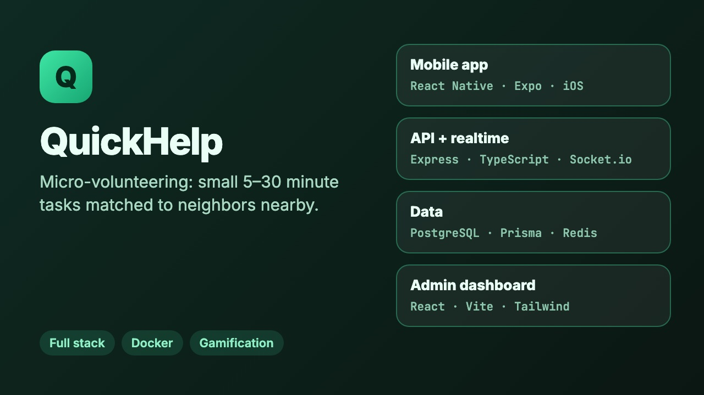

# QuickHelp

QuickHelp is for small favors: carrying groceries up the stairs, a quick tech question, walking a dog once. Someone posts a request that takes 5 to 30 minutes, and a nearby volunteer picks it up. Volunteers earn XP, keep streaks and collect badges, so helping out feels a bit like a game.



## What's in here

```
mobile/    React Native app (Expo)
backend/   Express + TypeScript API, Prisma, Socket.io
admin/     React + Vite admin dashboard
shared/    types shared between them
```

**The app** covers sign-up, posting a request with a location and photos, browsing requests near you on a map, accepting one, chatting with the other person in real time, and rating each other afterwards. There's also a social side: following people, a social feed with posts, and community groups.

**The backend** is an Express API in TypeScript with PostgreSQL through Prisma (27 tables). Socket.io handles chat and live updates. Redis is used as a cache, and JWTs for auth, with rate limiting on the auth routes. Gamification is its own service: XP events, levels, streaks, badges, achievements and challenges. Requests go through an OpenAI moderation check before they're posted. Volunteers can be required to pass a background check through Sterling, and there's a simulator so this can be tested without paying for real checks.

**The admin dashboard** shows users, requests and reports, plus charts of activity over time.

## Running it locally

You need Node 20+ and Docker.

```bash
docker compose up -d postgres redis

cd backend
cp .env.example .env          # fill in your own keys
npm install
npx prisma migrate dev
npm run seed                  # sample users and requests
npm run dev                   # API on http://localhost:4000

cd ../mobile
npm install
npx expo start                # press i for the iOS simulator

cd ../admin
npm install
npm run dev                   # http://localhost:5173
```

Maps, push notifications, uploads and moderation need their own API keys (Google Maps, Firebase, S3, OpenAI). Without them the core request, match and chat flow still works locally.

The backend deploys from `backend/Dockerfile`. I've been running it on Railway.

## Notes

- `docs/deployment.md` has deployment details, and `docs/app-store.md` has the store listing draft.
- MIT license.
